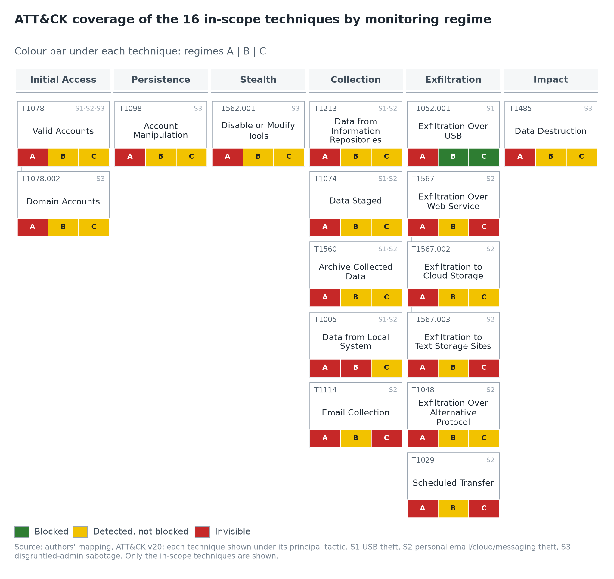
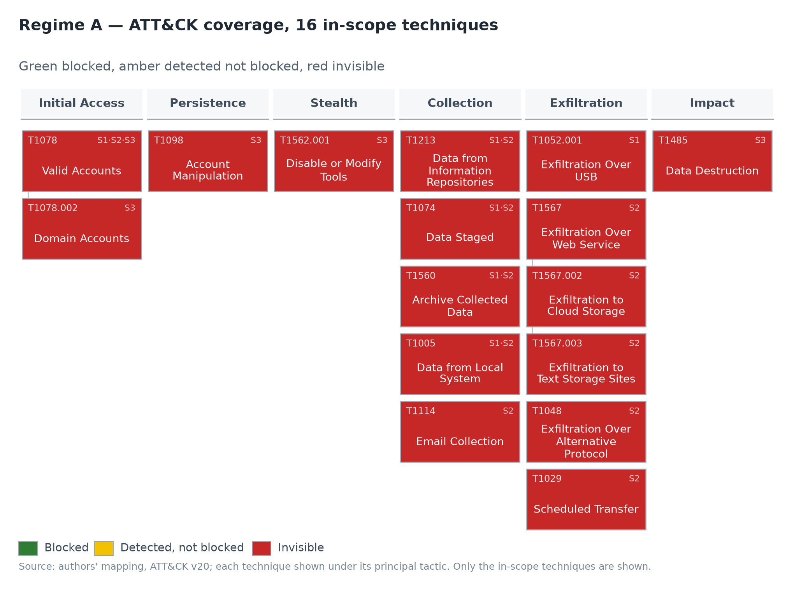
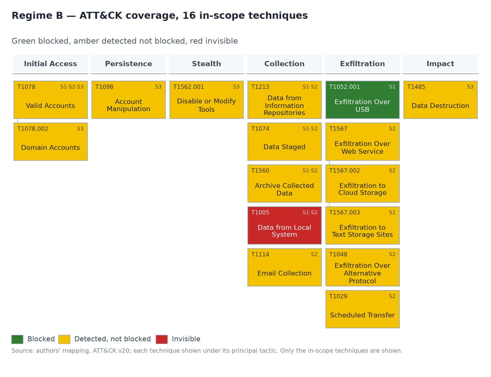
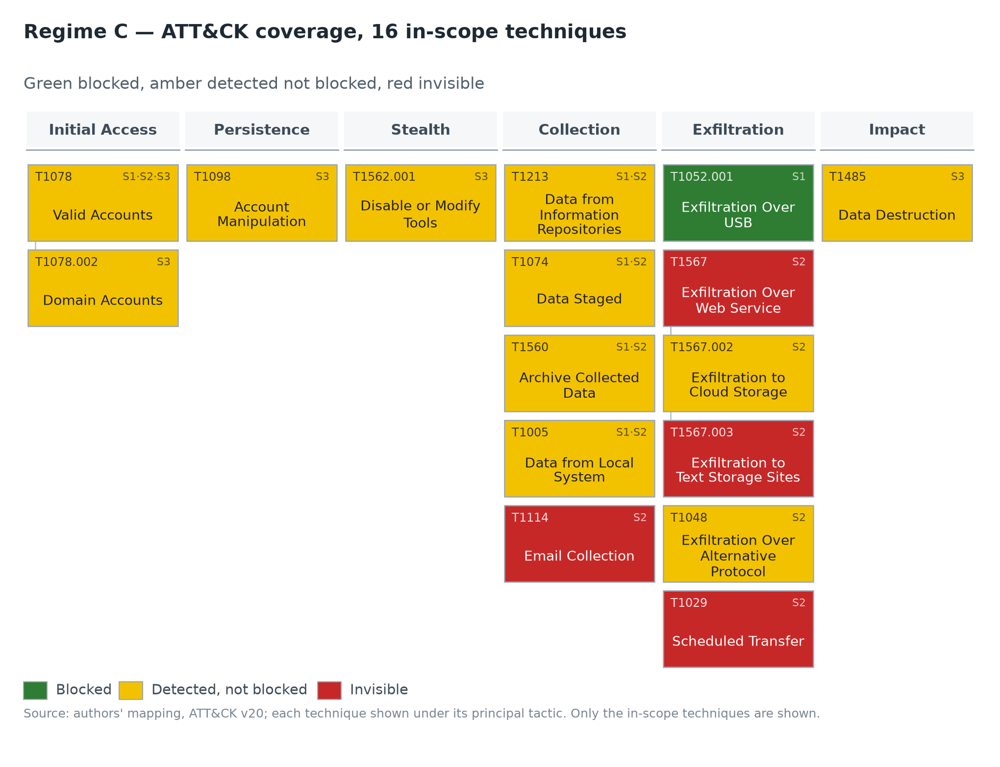
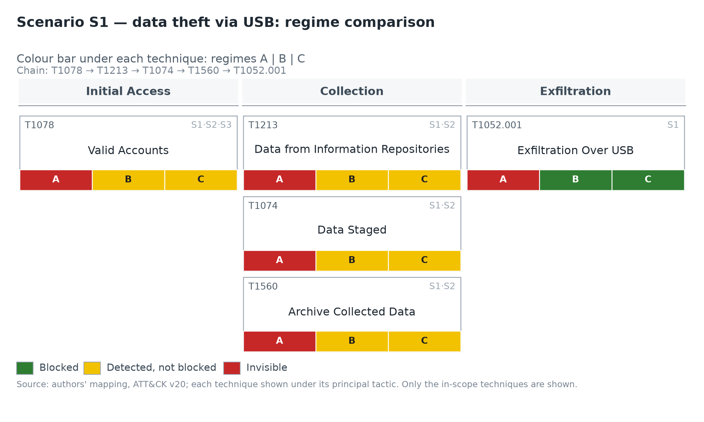
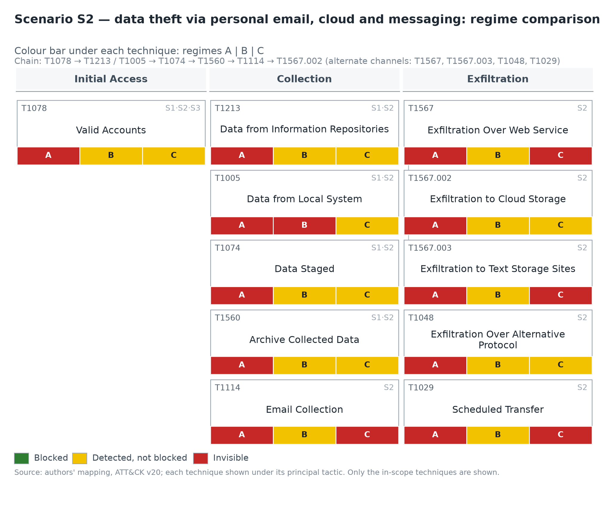
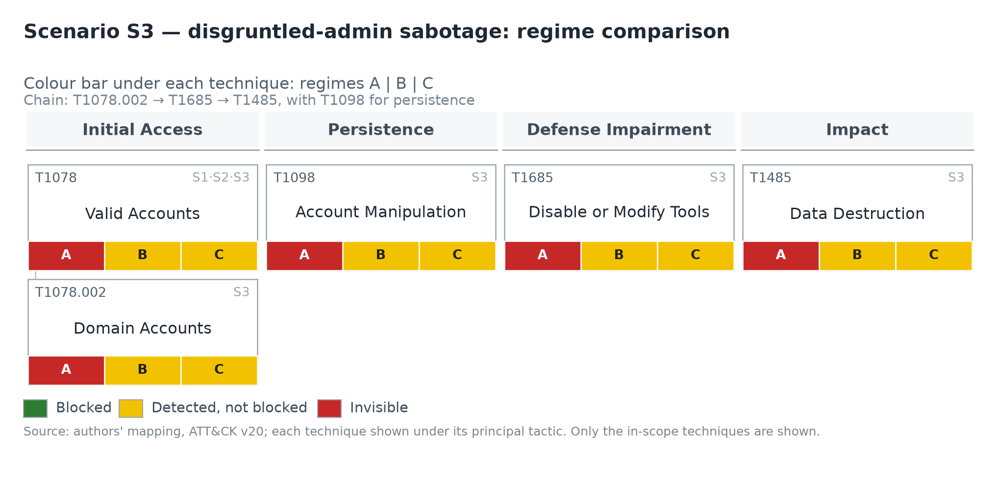

## 1. Purpose and scope

This document records the MITRE ATT&CK mapping used as the initial framework for comparing the three monitoring regimes. It identifies which in-scope techniques each regime blocks, detects without blocking, or cannot see, and provides qualitative context for the FAIR-based cost simulation; the simulation does not read the mapping or calculate its inputs from technique coverage. The mapping follows ATT&CK v20, including the Defense Impairment split, and places each technique under a single principal tactic. Only the 16 in-scope techniques are mapped; the technique table in the figure-generation script (`TECHS`) is the source of truth for the intended statuses and static figures; existing Navigator layers have discrepancies described below.

## 2. Regimes and scenarios

| Regime | Definition |
|---|---|
| A | No additional insider-threat monitoring program |
| B | Maximum surveillance, including communications content and sentiment analysis |
| C | Privacy-preserving monitoring: restricted data use, anonymization, endpoint and network metadata retained, message content excluded |

| Scenario | Description |
|---|---|
| S1 | Data theft via USB |
| S2 | Data theft via personal email, cloud and messaging |
| S3 | Disgruntled-admin sabotage |

## 3. Coverage taxonomy

| Status | Colour | Meaning |
|---|---|---|
| Blocked | Green (`#2E7D32`) | A preventive control stops the technique; the attempt does not succeed through this path |
| Detected, not blocked | Amber (`#F2C200`) | The regime produces telemetry or alerts, but prevention is not guaranteed |
| Invisible | Red (`#C62828`) | The regime produces no telemetry for the technique; the attempt proceeds unobserved |

The blocked label describes the intended control on the mapped path; the model retains nonzero S1 success probabilities to represent residual control failure or bypass. These residual probabilities are assumptions rather than a quantified control assessment. Detection is not equated with prevention. The simulation assigns success probabilities to scenarios, not individual techniques; coverage labels do not determine those probabilities.

## 4. In-scope techniques and regime coverage

| ID | Technique | Principal tactic | Scenarios | A | B | C |
|---|---|---|---|---|---|---|
| T1078 | Valid Accounts | Initial Access | S1 S2 S3 | Invisible | Detected | Detected |
| T1078.002 | Domain Accounts | Initial Access | S3 | Invisible | Detected | Detected |
| T1098 | Account Manipulation | Persistence | S3 | Invisible | Detected | Detected |
| T1685 | Disable or Modify Tools | Defense Impairment | S3 | Invisible | Detected | Detected |
| T1213 | Data from Information Repositories | Collection | S1 S2 | Invisible | Detected | Detected |
| T1074 | Data Staged | Collection | S1 S2 | Invisible | Detected | Detected |
| T1560 | Archive Collected Data | Collection | S1 S2 | Invisible | Detected | Detected |
| T1005 | Data from Local System | Collection | S1 S2 | Invisible | Invisible | Detected |
| T1114 | Email Collection | Collection | S2 | Invisible | Detected | Invisible |
| T1052.001 | Exfiltration Over USB | Exfiltration | S1 | Invisible | Blocked | Blocked |
| T1567 | Exfiltration Over Web Service | Exfiltration | S2 | Invisible | Detected | Invisible |
| T1567.002 | Exfiltration to Cloud Storage | Exfiltration | S2 | Invisible | Detected | Detected |
| T1567.003 | Exfiltration to Text Storage Sites | Exfiltration | S2 | Invisible | Detected | Invisible |
| T1048 | Exfiltration Over Alternative Protocol | Exfiltration | S2 | Invisible | Detected | Detected |
| T1029 | Scheduled Transfer | Exfiltration | S2 | Invisible | Detected | Invisible |
| T1485 | Data Destruction | Impact | S3 | Invisible | Detected | Detected |

The tactic ordering also defines Stealth, but no in-scope technique is assigned to it; the Stealth column is therefore omitted from all rendered matrices. Sub-techniques are indented beneath their parent where the parent is present (T1078.002 under T1078; T1567.002 and T1567.003 under T1567).

## 5. Scenario attack chains

- **S1 (USB theft):** T1078 → T1213 → T1074 → T1560 → T1052.001
- **S2 (personal email/cloud theft):** T1078 → T1213 / T1005 → T1074 → T1560 → T1114 → T1567.002, with alternate channels T1567, T1567.003, T1048 and T1029
- **S3 (admin sabotage):** T1078.002 → T1685 → T1485, with T1098 for persistence. The parent T1078 is retained on the S3 plate to show the sub-technique hierarchy.

T1005 is tagged as applicable to both S1 and S2 in the coverage table; it is drawn within the S2 chain in the scenario figures.

## 6. Regime comparison

| Regime | Blocked | Detected, not blocked | Invisible |
|---|---|---|---|
| A | 0 | 0 | 16 |
| B | 1 | 14 | 1 |
| C | 1 | 11 | 4 |

| Scenario | Techniques shown | A | B | C |
|---|---|---|---|---|
| S1 | 5 | 5 invisible | 4 detected, 1 blocked | 4 detected, 1 blocked |
| S2 | 11 | 11 invisible | 10 detected, 1 invisible | 7 detected, 4 invisible |
| S3 | 5 (incl. T1078) | 5 invisible | 5 detected | 5 detected |

Key asymmetries, as specified by the authors' mapping:

- **USB device control (T1052.001)** is a preventive technical control independent of content monitoring, so B and C block it identically. S1 coverage is therefore identical under B and C.
- **C's four blind spots are all in S2:** T1114, T1567, T1567.003 and T1029. Under the privacy constraints, message-content inspection and general web-service payload visibility are excluded; C retains metadata-level detection of known cloud-storage destinations (T1567.002) and alternative-protocol transfers (T1048).
- **B's single blind spot is T1005.** B's telemetry is communications- and egress-oriented, so local file collection produces no signal; C retains endpoint collection telemetry and detects it.
- **S3 coverage is identical under B and C.** Differences between the regimes in S3 outcomes arise from attempt rates in the simulation, not from coverage.

## 7. ATT&CK Navigator layers

Nine scenario–regime layer files accompany this mapping. The table below gives the intended coverage of each scenario chain; the existing files do not all match it.

| Layer | Scenario | Regime | Coverage profile |
|---|---|---|---|
| S1–A | USB theft | A | 5 invisible |
| S1–B | USB theft | B | 4 detected, 1 blocked |
| S1–C | USB theft | C | 4 detected, 1 blocked |
| S2–A | Email/cloud theft | A | 11 invisible |
| S2–B | Email/cloud theft | B | 10 detected, 1 invisible |
| S2–C | Email/cloud theft | C | 7 detected, 4 invisible |
| S3–A | Admin sabotage | A | 5 invisible |
| S3–B | Admin sabotage | B | 5 detected |
| S3–C | Admin sabotage | C | 5 detected |

The existing Navigator JSON layers do not consistently match the table or static plates, and `rc-s1.json` contains three layers. Treat the static figures and `TECHS` as the authoritative project mapping until the JSON layers are reconciled. The figure script does not generate Navigator layers; changes require a separate JSON update and verification. See the [consistency audit](../project-audits/Project%20consistency%20audit.md).

## 8. Report figures

The self-contained script (no input files) exports every figure as PNG (300 dpi), SVG and PDF into the output directory (default `report/figs`).

| Figure | View | Content | Placement |
|---|---|---|---|
| `fig_coverage` | Stripe matrix | All 16 techniques; A \| B \| C colour bar under each tile | Report body |
| `fig_regime_A` | Solid-fill matrix | All 16 techniques coloured for Regime A | Appendix / layer plate |
| `fig_regime_B` | Solid-fill matrix | All 16 techniques coloured for Regime B | Appendix / layer plate |
| `fig_regime_C` | Solid-fill matrix | All 16 techniques coloured for Regime C | Appendix / layer plate |
| `fig_scenario_S1` | Stripe matrix | S1 chain only, with chain caption | Scenario card |
| `fig_scenario_S2` | Stripe matrix | S2 chain and alternate channels, with chain caption | Scenario card |
| `fig_scenario_S3` | Stripe matrix | S3 chain only, with chain caption | Scenario card |

*Figure 1. Coverage across all three regimes.*

*Figure 2. Regime A coverage.*

*Figure 3. Regime B coverage.*

*Figure 4. Regime C coverage.*

*Figure 5. S1: USB theft chain.*

*Figure 6. S2: email and cloud theft chain and alternate channels.*

*Figure 7. S3: administrator sabotage chain.*

Each figure carries the legend (green blocked, amber detected not blocked, red invisible) and the source line: "Source: authors' mapping, ATT&CK v20; each technique shown under its principal tactic. Only the in-scope techniques are shown." The script also prints an ID/scenario/A/B/C audit table (`inv`/`det`/`blk`) to the console for verification against this document.

## 9. Use in the risk model

The coverage map informs, but does not determine, the success-probability triples in Appendix A of the simulation:

| Scenario | A | B | C | Coverage rationale |
|---|---|---|---|---|
| S1 | 0.50 / 0.70 / 0.90 | 0.05 / 0.10 / 0.20 | 0.05 / 0.10 / 0.20 | USB blocked under both B and C |
| S2 | 0.60 / 0.80 / 0.95 | 0.20 / 0.35 / 0.50 | 0.30 / 0.45 / 0.60 | C's four content-visibility blind spots |
| S3 | 0.50 / 0.70 / 0.90 | 0.10 / 0.20 / 0.30 | 0.10 / 0.20 / 0.30 | Identical B/C coverage |

Consistent with the methodology's stated limitations, ATT&CK describes controls without establishing success probabilities; the triples remain team-defined assumptions. The map captures control visibility only. Behavioural responses to surveillance (B's elevated S2/S3 attempt rates and turnover effects) and enforcement exposure are modelled separately in the simulation and are outside the scope of this mapping.