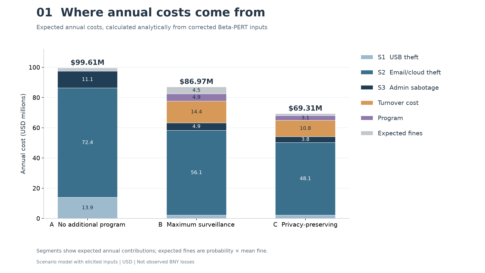
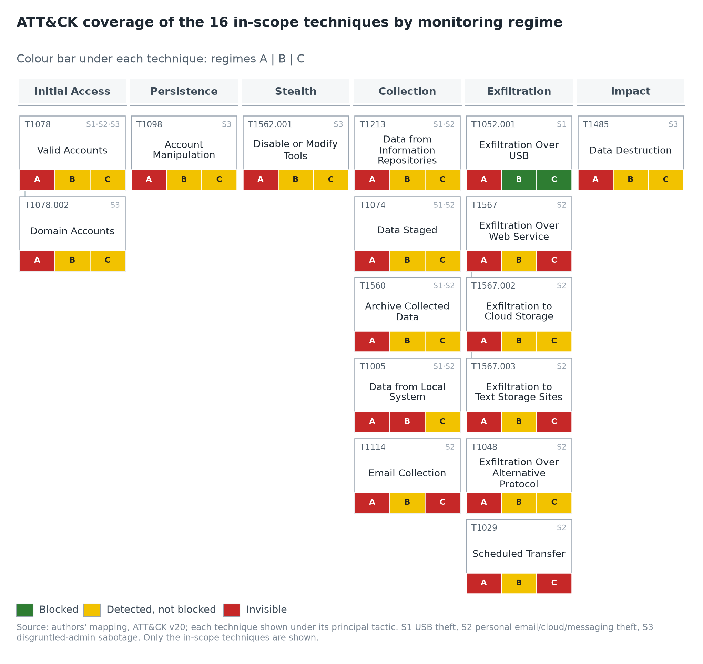
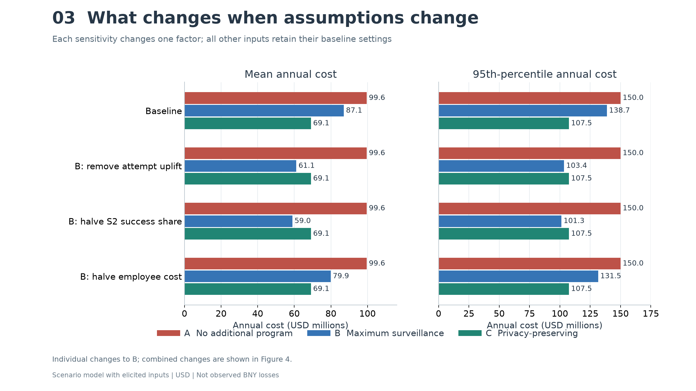

# Results: Insider-Threat Monitoring at BNY Scale

## Overview

The analysis compared three approaches to insider-threat monitoring using a model scaled to BNY's workforce. Under the assumptions used in the current model, privacy-preserving monitoring (Regime C) produced the lowest expected annual cost and the lowest 95th-percentile cost. Maximum surveillance (Regime B) also reduced expected costs relative to the baseline, but its greater assumed employee and enforcement costs, together with higher assumed attack attempts, offset some of its security benefits.

These results are scenario estimates, not observed losses or a description of BNY's actual monitoring practices. The model is intended to show how the balance of security, monitoring and employee costs changes under different assumptions.

## Comparison of monitoring regimes

The three regimes were assessed against USB data theft (S1), personal email or cloud exfiltration (S2), and administrator sabotage (S3). Regime A represents no additional insider-threat monitoring program; Regime B represents maximum surveillance, including communications content and sentiment analysis; and Regime C combines monitoring with restrictions on data use and privacy safeguards.

The Monte Carlo model simulated 20,000 years for each regime. Annual cost includes incident losses, the monitoring program, an illustrative first-year employee replacement cost and any modeled enforcement penalty. All amounts are in US dollars.

| Regime | Mean annual cost | 95th-percentile annual cost |
|---|---:|---:|
| A — No additional program | $99.57 million | $150.00 million |
| B — Maximum surveillance | $87.06 million | $138.74 million |
| C — Privacy-preserving monitoring | **$69.10 million** | **$107.46 million** |

C's simulated mean was approximately $30.47 million lower than A's and $17.96 million lower than B's. Its 95th-percentile cost was also lower than both alternatives. The 95th percentile is the threshold at or below which approximately 95% of simulated annual costs fell; it is not a maximum possible cost or a confidence interval.

The project's web explorer reports analytical expected costs of $99.61 million, $86.97 million and $69.31 million for A, B and C respectively. These use the same baseline assumptions but calculate expectations directly rather than estimating them from simulated years. Small differences from the simulation means are expected from sampling.

## Sources of modeled cost

The following breakdown uses analytical expectations, so its totals do not exactly match the simulated means above.

| Expected annual cost component ($ millions) | A | B | C |
|---|---:|---:|---:|
| S1 — USB theft | 13.86 | 2.15 | 2.15 |
| S2 — Personal email/cloud exfiltration | 72.42 | 56.12 | 48.10 |
| S3 — Administrator sabotage | 11.08 | 4.89 | 3.78 |
| Monitoring program | 0.00 | 4.92 | 3.08 |
| Employee replacement | 0.00 | 14.40 | 10.85 |
| Expected enforcement penalty | 2.25 | 4.50 | 1.35 |

Personal email and cloud exfiltration was the largest modeled cost in every regime. Although B has a lower assumed success probability for this scenario than C, it also has a substantially higher assumed number of attempts. As a result, B's expected S2 loss is higher in the baseline. This reflects the project's assumptions about employee behaviour under monitoring; it is not evidence that surveillance would cause additional attacks at BNY.

The employee replacement amounts are fixed first-year estimates. They apply assumed differences in turnover intention to a workforce of 48,100, then assume that 25% of the intention gap converts to departures and 80% of those departures are replaced. The resulting costs are approximately $14.40 million for B and $10.85 million for C. The underlying survey evidence concerns turnover intention, not observed departures caused by these regimes. Alert triage and morale or productivity effects are not included, so the totals do not capture every potential cost.

*Figure 1. Expected cost components under the current baseline assumptions.*

## Coverage of insider-threat techniques

The MITRE ATT&CK mapping provides a qualitative view of the controls assumed in each regime. Of the 16 techniques in scope, A has no additional modeled visibility; B detects 14, blocks one and leaves one invisible; C detects 11, blocks one and leaves four invisible. Detection means telemetry or an alert is available, not that an attack is prevented.

B and C both include the same modeled USB blocking control and have the same mapped coverage for the administrator sabotage chain. B has broader visibility over email and web-service exfiltration, while C retains endpoint and network metadata coverage but excludes certain content inspection. The mapping informs the assumed success probabilities; it does not establish their numerical values or measure the effectiveness of an actual BNY control.

*Figure 2. Project mapping of the 16 in-scope techniques. Green indicates blocked, amber detected and red invisible.*

## Sensitivity of the result

The preference for C depends on the assumptions used for B. In one-at-a-time simulations, removing B's additional S2 and S3 attempts reduced its mean cost to $61.11 million, while halving its S2 success probabilities reduced it to $58.96 million. Both values are below C's baseline simulated mean of $69.10 million. Halving B's employee replacement cost alone reduced its mean to $79.86 million, leaving C lower.

A separate analytical break-even calculation indicates that B's S2 success probabilities would need to fall to approximately 68.5% of their baseline values—a relative reduction of about 31.5%—for B and C to have equal expected costs, with the other assumptions held fixed. In the turnover-only sensitivity, B remained more expensive than C across the tested intention gaps and conversion rates. These comparisons change selected inputs while leaving others unchanged; they are not forecasts of what a real program would achieve.

*Figure 3. Effect of selected changes to B's assumptions on simulated mean cost.*

## Interpretation and limitations

The results support considering privacy safeguards alongside security controls when designing an insider-threat program. They also show that the estimated effectiveness of controls against email and cloud exfiltration, and the effect of monitoring on employee behaviour, are especially important to the decision. C has lower modeled cost despite some visibility gaps because the baseline assigns B more attempts and higher employee, program and enforcement costs.

The attempt rates, success probabilities, loss ranges, enforcement probabilities and employee responses are scenario assumptions, not estimates calibrated to BNY's internal data. The turnover calculation uses an association from a survey as a starting point and assumes a conversion to departures; it does not establish a causal effect. The model also treats inputs independently and uses bounded loss distributions. These limitations mean the ranking should be tested with operational data before it is used to select a policy.

A practical next step would be to estimate attempted and successful incidents by channel, control effectiveness, program and alert-handling costs, monitoring coverage, and employee departures and replacement costs. Those measurements would allow the assumptions with the greatest effect on the result to be recalibrated.

## Supporting project documents

- [Methodology and model inputs](../../report/Document%204%20%E2%80%94%20Methodology.md)
- [MITRE ATT&CK mapping](../../report/Document%205%20%E2%80%94%20MITRE%20Navigation.md)
- [Employee surveillance evidence](../../report/Document%202%20%E2%80%94%20Surveillance%20Effects%20on%20Employees.md)
- [BNY background](../../report/Document%203%20%E2%80%94%20BNY%20Background.md)
- [Simulation reproduction and baseline results](../README.md)
- [Turnover assumptions and evidence](../monitoring_turnover_findings.md)
- [Interactive model](../../web/README.md)
